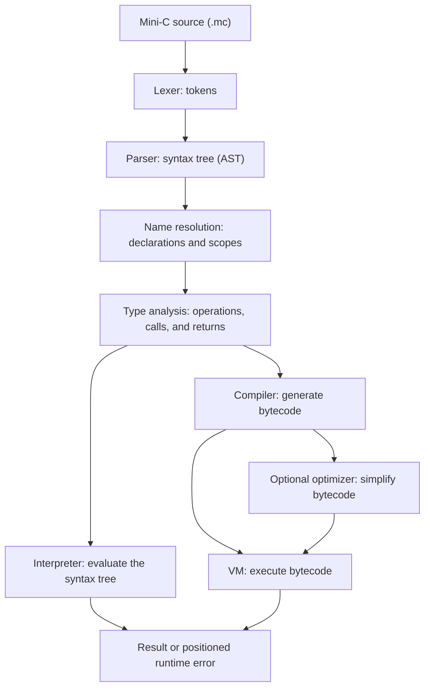

# Compiler Mini-C

I built this project to study how source code becomes a running program. Mini-C is a small C-like language with functions, static types, control flow, recursion, and local arrays.

The implementation uses C++ and the standard library, with no external C++ libraries or parser generator.

The project includes an interpreter that evaluates the parsed program directly and a compiler that produces bytecode.
Bytecode is an instruction sequence for a virtual machine (VM).
A local optimizer simplifies those instructions before execution.
All three execution modes share the same language rules and runtime diagnostics.

Each stage has a command that exposes its output, so you can follow a program through the implementation.
The [roadmap](docs/roadmap.md) records the completed work, including parsing exercises and a separate C/LLVM laboratory.

## Build and run

Use CMake 3.20 or later and a compiler with C++17 support.
The compiler and its tests require no LLVM installation.
From the repository root, configure the build:

```bash
cmake -S . -B build
cmake --build build
```

Start with [examples/factorial.mc](examples/factorial.mc):

```c
int factorial(int n) {
  if (n < 2) return 1;
  return n * factorial(n - 1);
}

int main() {
  return factorial(6);
}
```

After the build, compile, optimize, and execute the example:

```bash
./build/minic --run-vm-opt examples/factorial.mc
```

The command prints:

```text
720
```

The command starts at `main`, which calls `factorial(6)`.
Each recursive call has its own parameter and local storage.
Successful execution exits with status 0, independently of the Mini-C return value.

To compare the execution modes, use the same file:

```bash
./build/minic --run examples/factorial.mc
./build/minic --run-vm examples/factorial.mc
./build/minic --run-vm-opt examples/factorial.mc
```

Each command prints `720` and exits with status 0.

## How it works

The compiler separates reading source code, analyzing its meaning, and executing the program.
An abstract syntax tree (AST) records the parsed program structure.
Both execution paths use name and type analysis before they start.



The command-line modes also let you stop at tokens, the AST, resolved names, type analysis, or bytecode.

### Read and analyze the source

The [lexer](src/lexer.cpp) separates source text into names, numbers, keywords, and punctuation.
It recognizes 35 token types and chooses the longest supported operator, such as `==` before `=`.
Tokens own their text and retain positions, so later stages can report where an error occurred.
This lets tokens remain valid after the source buffer expires.
Lines and byte columns start at 1.

The [parser](src/parser.cpp) uses recursive descent, with C++ functions that follow grammar rules.
It builds the AST and applies operator precedence, so `a + b * c` groups as `a + (b * c)`.
This design keeps grammar decisions visible in the source and avoids a parser-generator dependency.

[Name resolution](src/name_resolution.cpp) connects each use of a name to its declaration.
It handles nested scopes, shadowing, forward function calls, and duplicate or missing names.
The [type checker](src/type_checker.cpp) then rejects incompatible operations, assignments, arguments, returns, and array uses.
It also requires non-void functions to guarantee a return value.

### Execute the program in two ways

The [interpreter](src/interpreter.cpp) walks the AST and evaluates expressions and statements directly.
It provided the first executable path through the language and remains a reference for VM tests.
Parameters copy their values, and each function call owns its local storage.

The [bytecode compiler](src/bytecode_compiler.cpp) translates the analyzed AST into stack instructions.
Its instruction set has 29 operations for values, local storage, arrays, branches, calls, returns, and source-step accounting.
The [VM](src/vm.cpp) executes those instructions with an explicit value stack and call frames, which hold each call's execution state.
VM calls use stored frames instead of recursive C++ calls.

The interpreter and VM use the same checked arithmetic helpers.
Comparing their results helps detect mistakes in instruction generation, evaluation order, and function calls.
The comparison includes runtime errors and their source positions.

### Optimize without changing behavior

The [optimizer](src/bytecode_optimizer.cpp) evaluates safe constant expressions, simplifies known branches, redirects redundant jumps, and removes unreachable instructions.
For example, it can replace the arithmetic in `(2 + 3) * 4` with the constant `20`.
On reachable paths, it preserves operations that can fail or change program state, including reads of variables without values.

Source-step markers count executed source expressions and statements.
The optimizer preserves their observable behavior, so optimization does not change when a source-step limit stops execution.
It also preserves arithmetic errors, array errors, and call-depth limits.

For [examples/optimization.mc](examples/optimization.mc), optimization reduces the instruction count from 69 to 36.
The interpreter, VM, and optimized VM all return `24`.
This comparison measures instruction count.

After the build, inspect both instruction sequences from the repository root:

```bash
./build/minic --bytecode examples/optimization.mc
./build/minic --bytecode-opt examples/optimization.mc
```

## Language and runtime rules

| Area | Implemented behavior |
|------|----------------------|
| Types | Distinct `int`, `bool`, and `void`, with no implicit conversion between integers and booleans |
| Expressions | Arithmetic, comparisons, logical operators, assignment, and named function calls |
| Control flow | Blocks, `if`/`else`, `while`, and `return` |
| Functions | Scalar parameters and results, forward calls, and direct or mutual recursion |
| Local arrays | One-dimensional `int` or `bool` arrays, with lengths from 1 through 1024 |
| Integer arithmetic | Signed 64-bit values, with positioned overflow and zero-divisor errors |
| Initialization | Variables and array elements have no value until an initializer or assignment supplies one |
| Evaluation order | Left before right, with logical operators that skip unnecessary operands |

Every executed array declaration resets its elements.
Indexed assignment checks and saves its index before evaluating the assigned value.
Array reads detect invalid indices and elements without values.

Execution defaults to 1000000 source steps and 128 active calls, including the entry frame.
The C++ APIs accept positive custom limits and another parameterless entry function.
The command-line interface executes parameterless `main` with the defaults.

A successful integer or boolean result prints with a newline.
A successful `void` result prints nothing.
Failures exit with status 1, write diagnostics to standard error, and print no partial result.

The [language reference](docs/language.md#current-grammar) defines the grammar and detailed semantics.
The [execution boundaries](docs/architecture.md#execution-boundaries) describe numeric, storage, and resource limits.

## Inspect each stage

After the build, invoke `./build/minic` from the repository root with one mode and one source path.
Use `./build/minic --help` for usage.

| Mode | What you can inspect |
|------|----------------------|
| `--tokens <file>` | Token types, owned source text, and positions |
| `--ast <file>` | Parsed expressions, statements, and function structure |
| `--resolve <file>` | Scopes, symbols, and bindings between uses and declarations |
| `--check <file>` | Name and type errors, with no output on success |
| `--bytecode <file>` | Generated stack instructions |
| `--bytecode-opt <file>` | Optimized stack instructions |
| `--run <file>` | Execution through the interpreter |
| `--run-vm <file>` | Execution through the VM |
| `--run-vm-opt <file>` | Execution through the VM after optimization |

For example, inspect the array program after the build:

```bash
./build/minic --tokens examples/arrays.mc
./build/minic --ast examples/arrays.mc
./build/minic --resolve examples/arrays.mc
./build/minic --check examples/arrays.mc
```

Token and AST modes remain independent of name and type rules.
Name resolution does not analyze types or initialization.
Execution and bytecode modes analyze the complete source before compilation or execution, including code that execution never reaches.

## Examples to explore

After the build, pass an example path to `--run`, `--run-vm`, or `--run-vm-opt`.
All three modes produce the same output and status for these examples:

| Example | Demonstrates | Output |
|---------|--------------|--------|
| [hello.mc](examples/hello.mc) | A minimal entry function | `0` |
| [interpreter.mc](examples/interpreter.mc) | Arithmetic, assignment, and nested scope | `42` |
| [calls.mc](examples/calls.mc) | Parameters and nested calls | `6` |
| [scopes.mc](examples/scopes.mc) | Shadowing and a forward function call | `1` |
| [types.mc](examples/types.mc) | Matching types, calls, and returns | `2` |
| [short_circuit.mc](examples/short_circuit.mc) | Logical evaluation that skips a failing operand | `true` |
| [factorial.mc](examples/factorial.mc) | Direct recursion | `720` |
| [fibonacci.mc](examples/fibonacci.mc) | Two recursive calls per case | `55` |
| [optimization.mc](examples/optimization.mc) | Constant expressions, a known branch, and unreachable code | `24` |
| [arrays.mc](examples/arrays.mc) | Integer and boolean arrays, indexed writes, calls, and a loop | `10` |
| [lexer.mc](examples/lexer.mc) | All 33 original token types. The array example adds both brackets | `0` |

The remaining examples demonstrate analysis boundaries and expected failures:

| Example | Expected behavior |
|---------|-------------------|
| [expressions.mc](examples/expressions.mc) | `--ast` succeeds. Name analysis rejects undeclared `left` at line 9, column 10 |
| [control_flow.mc](examples/control_flow.mc) | Analysis succeeds. Execution reports a missing `main` because the file defines only helper functions |
| [recursion.mc](examples/recursion.mc) | Analysis accepts mutual recursion. Execution reports a missing `main` |
| [type_error.mc](examples/type_error.mc) | Syntax and names succeed. Type analysis rejects an integer initializer for `bool` at line 3, column 16 |
| [runtime_error.mc](examples/runtime_error.mc) | Type analysis succeeds. Execution rejects a variable read without a value at line 3, column 15 |
| [array_error.mc](examples/array_error.mc) | Type analysis succeeds. Execution rejects `values[1]` without a value at line 5, column 10 |

After the build, use the array error example to inspect a runtime diagnostic:

```bash
./build/minic --run-vm-opt examples/array_error.mc
```

The command prints no standard output and exits with status 1.
Standard error contains:

```text
examples/array_error.mc:5:10: error: The array element "values[1]" has no value.
```

## Tests

Tests run locally through CTest, which is part of CMake.
After the build, execute the suite from the repository root:

```bash
ctest --test-dir build --output-on-failure
```

The suite contains 398 cases across compiler stages, commands, and execution engines.
Tests inspect parsed structures and generated instructions, compare exact command output, and exercise errors, ownership, evaluation order, and execution limits.

Differential tests compare the same program across execution engines.
They require agreement on values, runtime diagnostics, source positions, and behavior when an execution limit stops the program.
The example gallery covers all 17 Mini-C files across the three execution modes, including expected failures.

The [sanitizer guide](docs/tech-stack.md#sanitizer-validation) records a 398-test baseline and provides reproduction commands.
AddressSanitizer detects memory access errors, and UndefinedBehaviorSanitizer detects selected undefined C++ operations.
Build directories and generated binaries remain outside version control.

## Parsing theory and LLVM study

The [parsing notes](docs/theory-parsing.md) connect the manual parser to worked FIRST/FOLLOW sets, predictive parsing decisions, and a shift/reduce trace.
FIRST and FOLLOW describe which tokens can start or follow grammar rules.
The notes compare LL and LR parsing methods and explain parser-generator trade-offs.

The [LLVM notes](docs/theory-llvm.md) connect the implemented stages to Clang and LLVM.
An intermediate representation (IR) records a program between compilation stages.
A separate C laboratory generates LLVM IR at `-O0` and `-O1`, then compiles both C and IR into native executables.

With Clang and CMake available, execute the laboratory from the repository root:

```bash
cmake -P tests/llvm_lab.cmake
```

Four native executions test five bounded cases each, print `10`, and exit with status 0.
The script records the compiler version and results under ignored `build-llvm-lab/`.
The committed IR examples record Apple Clang 17.0.0 and its target metadata.

This laboratory teaches IR reading, loop values, and optimization behavior.
The Mini-C compiler itself targets the custom bytecode VM.
The native C results establish the laboratory example's behavior and do not establish a native Mini-C backend.

## Scope and limits

This is an educational language implementation.
The language excludes pointers, structs, unions, strings, floating-point values, globals, prototypes, and dynamic allocation.
Arrays cannot act as whole values, parameters, or return values.
The language also excludes initializer lists and multidimensional arrays.

The project implements no general dataflow framework, register allocation, garbage collector, just-in-time compiler, binary bytecode loader, or LLVM backend.
Standalone `opt` and `llc` experiments remain optional and deferred.
The [coverage report](docs/curriculum-alignment.md) distinguishes implemented capabilities, completed study exercises, and excluded work.

Runtime budgets limit executed source steps and active calls.
They do not bound parser nesting, source size, native stack use, or total memory.
These limits do not provide a sandbox for untrusted programs.

## Repository map

```text
src/            Compiler stages, interpreter, bytecode, optimizer, and VM
examples/       Mini-C programs and the separate C/LLVM laboratory
tests/         C++ tests, command tests, and expected output fixtures
docs/          Language rules, architecture, study notes, and roadmap
```

| Document | Read it to understand |
|----------|-----------------------|
| [Architecture](docs/architecture.md#reference-map) | Stage boundaries, ownership, the instruction set, and execution limits |
| [Language](docs/language.md#current-grammar) | Grammar, types, evaluation order, and diagnostics |
| [Coverage](docs/curriculum-alignment.md) | Implemented work and comparisons with cited course material |
| [Parsing theory](docs/theory-parsing.md) | FIRST/FOLLOW, LL/LR examples, and parser-generator decisions |
| [LLVM study](docs/theory-llvm.md) | Stage mapping, annotated IR, and the native C laboratory |
| [Tooling](docs/tech-stack.md) | Dependencies, build commands, tests, and sanitizer commands |
| [Roadmap](docs/roadmap.md) | Completed phases and deferred optional work |
| [References](docs/references.md) | Books and study terms by phase |
| [Documentation index](docs/README.md) | The document catalog and front-matter conventions |

## License

This project uses the [MIT License](LICENSE).
