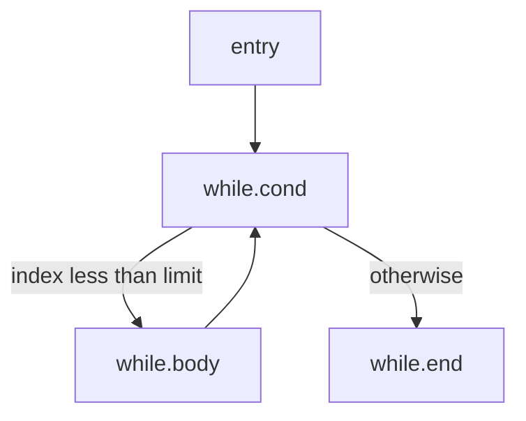

# LLVM literacy

Phase 12 connects the Mini-C implementation to LLVM vocabulary and a small C experiment.
An intermediate representation (IR) describes a program between source analysis and its final execution form.
The primary project artifact remains the Mini-C bytecode compiler and VM.
The [roadmap](roadmap.md#phase-12-llvm-literacy-conversation-fluency) records phase progress.

## Pipeline map

A front end reads source syntax and applies the source language rules.
A middle end analyzes or transforms an IR.
A back end produces instructions for an execution target.

| Purpose | Mini-C implementation | Clang/LLVM counterpart |
|---------|-----------------------|------------------------|
| Read source | Lexer and recursive-descent parser | Clang lexer and parser |
| Apply language rules | Name resolution and type analysis | Clang semantic analysis |
| Represent source structure | Owned `Program` AST | Clang AST |
| Lower analyzed code | `compile_bytecode` produces stack instructions | Clang generates LLVM IR |
| Transform code | `optimize_bytecode` preserves Mini-C effects and errors | LLVM analyses and transformation passes |
| Execute code | Interpreter or explicit-frame bytecode VM | Native code from a target back end, assembler, and linker |

Clang combines several compilation steps behind one command.
With `-S -emit-llvm`, it emits textual LLVM IR. With `-S` alone, it emits assembly for the selected target.
The linker combines object files and required libraries into an executable.
These roles follow the [Clang toolchain guide](https://clang.llvm.org/docs/Toolchain.html).

The mapping compares responsibilities, rather than interchangeable formats.
Mini-C bytecode is a stack IR with mutable local slots and explicit source steps.
LLVM IR uses named values and control-flow blocks. The current Mini-C compiler does not emit it.

## IR vocabulary

| Term | Meaning |
|------|---------|
| Module | A container for function definitions, declarations, and globals |
| Function | Typed arguments, a result type, and basic blocks |
| Basic block | Instructions with one entry and a terminating control-flow instruction |
| Instruction | One operation, sometimes with a result value |
| Control-flow graph | Basic blocks connected by possible control transfers |
| SSA | Static single assignment, with one definition for each named value |
| `phi` | A value selection based on the predecessor block |

An LLVM value such as `%next` has one definition. That definition can execute repeatedly inside a loop.
This differs from assigning new values to one C source variable.
A `phi` instruction selects the value associated with the block that just transferred control to its block.
It does not evaluate every incoming path.
The [LLVM language reference](https://llvm.org/docs/LangRef.html#phi-instruction) defines these value and control-flow rules.

Memory contents remain mutable even when their addresses are SSA values.
An `alloca` instruction creates stack storage, while `load` and `store` access its contents.
An optimizer can promote suitable local storage into SSA values and introduce `phi` instructions at control-flow joins.
The [LLVM mutable-variable tutorial](https://llvm.org/docs/tutorial/MyFirstLanguageFrontend/LangImpl07.html#memory-in-llvm) explains this distinction.

## Passes and tools

An analysis pass computes information about the IR.
A transformation pass changes the IR under its semantic rules.
A pass manager arranges passes and manages the analysis results that transformations preserve or invalidate.
An optimization level selects a pipeline of passes, rather than one named transformation.
The [pass manager guide](https://llvm.org/docs/NewPassManager.html) describes that organization.

| Tool | Role |
|------|------|
| `clang` | Compile C/C++, emit LLVM IR, or drive native compilation and linking |
| `opt` | Apply selected LLVM analyses or transformations to IR |
| `llc` | Lower LLVM IR to assembly for a selected target |

The [opt guide](https://llvm.org/docs/CommandGuide/opt.html) defines its IR pipeline interface.
The [llc guide](https://llvm.org/docs/CommandGuide/llc.html) separates target assembly generation from assembly and linking.

A target triple identifies an architecture and platform combination.
A data layout describes properties such as type sizes and alignment.
An IR module can contain both. Its target assumptions still matter when another machine compiles it.
The [front-end guidance](https://llvm.org/docs/Frontend/PerformanceTips.html#the-basics) explains why both affect optimization.

## Approved laboratory

The laboratory uses the installed Clang and standalone C files under `examples/llvm/`.
One function accumulates results from an external function inside a loop.
A separate file defines that function and checks small, bounded inputs.
Separate compilation keeps a call visible for the IR reading exercise without compiler-specific function attributes.

The comparison uses `-O0` and `-O1`, followed by native execution from both C and generated IR.
The `-O0` level disables most optimization, while `-O1` enables an optimization pipeline.
The `-fno-discard-value-names` flag retains descriptive IR names for the reading exercise.
The committed IR examples record one compiler and target. Generated names and instruction layouts can differ with another compiler version.
The exercise compares observed structures and results instead of requiring identical IR text on every host.

The compiler build and its 398 tests retain their C++ and CMake requirements.
Clang serves only this separate laboratory. The exercise adds no Mini-C command, language rule, or execution backend.
Standalone `opt` and `llc` execution remains optional because neither tool is available on this host's `PATH`.
The laboratory demonstrates LLVM concepts without installing tools or depending on LLVM libraries.

The C example uses C integer rules. It does not establish equivalence with Mini-C's checked signed 64-bit arithmetic.
An LLVM backend for Mini-C requires an explicit design for numeric errors, source positions, array checks, and execution limits.
That design remains outside phase 12.

## Reproduce the laboratory

The [sum function](../examples/llvm/sum.c) accumulates `next(index)` while `index < limit`.
The [driver](../examples/llvm/driver.c) defines `next(value)` as `value + 1` and checks these cases:

| Limit | Expected result |
|------:|----------------:|
| -2 | 0 |
| 0 | 0 |
| 1 | 1 |
| 4 | 10 |
| 8 | 36 |

All arithmetic stays within the C `int` range for these inputs.
The driver exits with status 1 if a case fails. Otherwise, it prints `10` and exits with status 0.
The two source files compile separately within each command, so the IR for `sum_next` retains an external call to `next`.

With CMake 3.20 or later and Clang on `PATH`, operate this command from the repository root:

```bash
cmake -P tests/llvm_lab.cmake
```

The [laboratory script](../tests/llvm_lab.cmake) creates `build-llvm-lab/`, which Git ignores.
It emits IR at `-O0` and `-O1`, compiles both C and IR paths, and checks all four native executions.
Each execution must print `10`, return status 0, and produce no standard error output.
The script also rejects compiler warnings. It records the compiler version and results in that directory.
It remains separate from CTest, so the compiler suite retains 398 tests and requires no Clang executable on `PATH`.

To select a Clang executable explicitly, pass its path before `-P`:

```bash
cmake -DCLANG_EXECUTABLE=/usr/bin/clang -P tests/llvm_lab.cmake
```

On another host, replace `/usr/bin/clang` with that host's Clang path.

After the script succeeds, inspect the generated files from the repository root:

```bash
cat build-llvm-lab/clang-version.txt
cat build-llvm-lab/results.txt
diff -u build-llvm-lab/sum.O0.ll build-llvm-lab/sum.O1.ll
```

The `diff` command returns status 1 when the IR files differ. The recorded compiler produces different files.
To reproduce one IR generation and native compilation manually, use Clang from the same environment:

```bash
clang -std=c17 -Wall -Wextra -Wpedantic -O1 \
  -S -emit-llvm -fno-discard-value-names \
  examples/llvm/sum.c -o build-llvm-lab/sum.O1.ll
clang -std=c17 -Wall -Wextra -Wpedantic -O1 \
  build-llvm-lab/sum.O1.ll examples/llvm/driver.c -o build-llvm-lab/from-ir.O1
./build-llvm-lab/from-ir.O1
```

The [Clang command guide](https://clang.llvm.org/docs/CommandGuide/clang.html) defines the optimization levels.
The `-O1` result includes a pipeline of transformations, so this comparison does not isolate a single pass.

## Recorded result

The committed [O0 IR](../examples/llvm/sum.O0.ll) and [O1 IR](../examples/llvm/sum.O1.ll) come from Apple Clang 17.0.0 (`clang-1700.6.4.2`).
Both modules record `arm64-apple-macosx15.0.0` as their target triple.
They retain the compiler's attributes and metadata as generated.
The reference files contain 54 and 43 lines, respectively. Line counts are observations, rather than performance measurements.
All four native executions pass the five cases without warnings, print `10`, and return status 0.

The O0 function uses three `alloca` instructions and explicit loads and stores.
The O1 function uses no `alloca` and contains three `phi` instructions.
Both contain one call to `next`.

## Read the O0 IR

The [O0 reference](../examples/llvm/sum.O0.ll) has four blocks: `entry`, `while.cond`, `while.body`, and `while.end`.
The module declares `next` because its definition lives in the separately compiled driver.
The `i32` type records a 32-bit integer for this host's C `int`.

```llvm
entry:
  %limit.addr = alloca i32, align 4
  %total = alloca i32, align 4
  %index = alloca i32, align 4
  store i32 %limit, ptr %limit.addr, align 4
  store i32 0, ptr %total, align 4
  store i32 0, ptr %index, align 4
  br label %while.cond
```

The three addresses remain named SSA values, while their stored contents can change.
The condition block loads `index` and `limit`, compares them with `icmp slt`, and branches on the resulting `i1` value.
The `slt` predicate means signed less than, and `i1` holds the comparison result.
The body calls `next`, adds its result to the total, updates the index, and returns to the condition block.
The exit block loads and returns the final total.

The following graph describes the O0 reference blocks:



## Read the O1 IR

The [O1 reference](../examples/llvm/sum.O1.ll) has three blocks: `entry`, `while.body`, and `while.end`.
The entry block tests whether the limit is positive. A nonpositive limit skips the loop and returns zero.
The loop keeps its index and accumulated total as values instead of local memory accesses.

```llvm
while.body:                                       ; preds = %entry, %while.body
  %index.07 = phi i32 [ %add1, %while.body ], [ 0, %entry ]
  %total.06 = phi i32 [ %add, %while.body ], [ 0, %entry ]
  %call = tail call i32 @next(i32 noundef %index.07) #2
  %add = add nsw i32 %call, %total.06
  %add1 = add nuw nsw i32 %index.07, 1
  %exitcond.not = icmp eq i32 %add1, %limit
  br i1 %exitcond.not, label %while.end, label %while.body, !llvm.loop !6
```

For `%index.07`, entry from `%entry` selects `0`. Entry from `%while.body` selects the preceding iteration's `%add1`.
The `%total.06` selection follows the same pattern, with zero initially and `%add` after an iteration.
Each named value has one definition in the IR, although control can revisit that definition.
These names identify IR values rather than physical CPU registers.

For `limit = 4`, the loop values follow this calculation:

| Body visit | `%index.07` | `%total.06` | `%call` | `%add` |
|-----------:|------------:|------------:|--------:|-------:|
| 1 | 0 | 0 | 1 | 1 |
| 2 | 1 | 1 | 2 | 3 |
| 3 | 2 | 3 | 3 | 6 |
| 4 | 3 | 6 | 4 | 10 |

The final `%add1` equals the limit, so the branch transfers control to `while.end`.
Its `%total.0.lcssa` selects `%add` from the loop body or zero from the entry block.
The return therefore produces `10` for this input and `0` for the driver's nonpositive inputs.
This table interprets the recorded IR with the driver's `next` definition, rather than an instruction trace captured during execution.

## Semantic limits

The `nsw` flag promises no signed wrap. On signed overflow, the flagged addition produces a poison value instead of a Mini-C error.
The [addition contract](https://llvm.org/docs/LangRef.html#add-instruction) defines that behavior.
A poison value represents deferred undefined behavior and can propagate through other instructions.
The [LLVM undefined-behavior manual](https://llvm.org/docs/UndefinedBehavior.html#poison-values) describes its consequences.
It does not provide the positioned numeric diagnostics that Mini-C implements.

The small driver inputs avoid C signed overflow, which [Clang classifies as undefined behavior](https://clang.llvm.org/docs/UndefinedBehaviorSanitizer.html#introduction).
They demonstrate the C and IR paths for this example. They do not compare every possible C input with Mini-C execution.
The laboratory also has no Mini-C array checks, source-step accounting, or call-depth limits.

The O0 reference contains the [`optnone` attribute](https://llvm.org/docs/LangRef.html#function-attributes), which suppresses most optimization of that function.
An optional future `opt` experiment needs an input and toolchain that permit the intended pass.
The completed experiment uses the tested Clang `-O0` and `-O1` pipelines.
Standalone `opt` and `llc` execution remains deferred. The source C files, rather than the target-specific reference IR, support regeneration on another host.

## Interview explanation

My Mini-C project has a manual front end, a tree-walk interpreter, and a compiler for a custom bytecode VM.
I implemented local optimization passes and checked arrays, then studied how those responsibilities map to Clang and LLVM.
LLVM IR separates source analysis from optimization and target code generation.
I compared Clang output at `-O0` and `-O1`, followed loop values and `phi` selections, and compiled the IR into native programs.
My implementation target is the bytecode VM. My LLVM work in this project covers IR reading and a reproducible C laboratory.

## Completion evidence

The normal compiler build passes all 398 CTest cases without compiler warnings.
The independent laboratory passes four native executions, each with five bounded cases, exact output, and exit-status checks.
The prose scan reports no findings, and local documentation links resolve.
The compiler sources and CMake targets retain their phase 11 contents.
The phase 11 sanitizer baseline remains separate from the phase 12 laboratory results.
